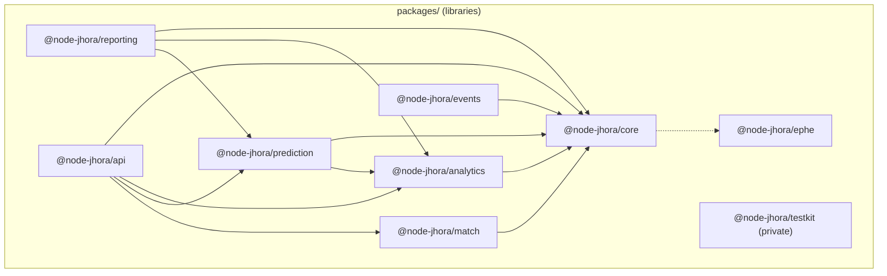

# Architecture

Node-Jhora is a pnpm-workspaces monorepo. **`packages/` holds libraries. `apps/` is for applications.** No `apps/` directory is checked in. A React UI is planned under `apps/` and should depend on package entry points, not on files inside `packages/*/src`.

`pnpm-workspace.yaml` globs `packages/*` and `apps/*`. Every package is ESM (`"type": "module"`). Internal dependencies use `workspace:*`.

## Layout

`@node-jhora/ephe` is a data package (`de440s.bsp` in the tarball). `@node-jhora/core` lists it as an optional peer dependency and resolves the kernel at runtime. The dotted edge is that runtime lookup, not a TypeScript project reference.

Root `tsconfig.json` `references`: `core`, `analytics`, `prediction`, `match`, `api`, `events`, `reporting`, `testkit`, so `pnpm build` (`tsc -b`) compiles every TypeScript workspace. `tools/check-tsrefs.test.ts` fails if a `packages/*/tsconfig.json` is missing from that list. `ephe` is not a TypeScript project.

## Packages

### `@node-jhora/core`

- **Ephemeris**: `EphemerisEngine` in `src/engine/ephemeris.ts` routes through `EphemerisProvider` (`packages/core/src/engine/provider/`). Default kernel: pure TypeScript SPK reader for JPL **DE440s** (`@node-jhora/ephe`, **1849-12-26 to 2150-01-22**). Optional long range: **DE431** compact chunks (`@node-jhora/ephe-long`, 10000 BCE–10000 CE) loaded on demand via an injectable chunk loader (HTTP in the browser, filesystem in Node). Policy `auto` keeps DE440s byte-identical inside its span. No Swiss Ephemeris package and no WASM binary.
- **Resolution order** for `de440s.bsp`: `NODE_JHORA_EPHE_PATH`, then `@node-jhora/ephe`, then the monorepo copy, then the user cache, then a SHA-256-verified download from JPL into that cache (skipped when `NODE_JHORA_OFFLINE=1`). See [ADR 0006](./decisions/0006-npm-packaging-and-ephemeris-data-distribution.md).
- **Ayanamsa**: `DEFAULT_AYANAMSA` and `DEFAULT_CONFIG.ayanamsaMode` are `AYANAMSA.TRUE_CITRA` (`27`), True Chitrapaksha, from Spica at 180°. `NodeJHora.calculate` defaults its name argument to `'TrueChitra'`. The HTTP schema defaults to `'true_chitra'`.
- **Registry**: `AYANAMSA_MODELS` in `src/engine/ayanamsa.ts` includes star modes 27, 29, 35 and epoch modes 0, 1, 3, 5, 18, plus true-epoch mode 46 (Lahiri ICRC). SE modes 2, 7, 8, and 28 throw `UnsupportedAyanamsaModeError`; other unknown codes throw `UnknownAyanamsaModeError`. Provenance and parity bounds: [DATA-SOURCES.md](DATA-SOURCES.md).
- **Other defaults** (`DEFAULT_CONFIG`): `positionMode: 'geometric'`, `nodeType: 'true'`, `houseSystem: 'WholeSign'`, `topocentric: false`.
- **Houses**: `wholeSignCusps` and `equalHouseCusps` in `src/engine/coordinates.ts`. `getHouses` selects Equal only when `method === 'E'`; every other method, including the `'P'` and `'O'` codes `calculateHouseCusps` passes for Placidus and Porphyry, gets Whole Sign cusps.
- **Vargas**: D1, D2, D3, D4, D7, D9, D10, D12, D16, D20, D24, D27, D30, D40, D45, D60 via `calculateVarga`. D2 and D10 take scheme options; other unknown divisors use the harmonic fallback.
- **Also exported**: panchanga, KP sub-lord and ruling planets, time-based and dhumadi upagrahas, and the special-lagna functions (Pranapada, Indu, Shree, Hora, Ghati, Bhava, Varnada).
- **`decimal.js`**: `src/core/precise.ts`, vargas, panchanga, and KP sub-lords. The SPK evaluation and the coordinate chain use JavaScript numbers.
- **Facade**: `NodeJHora`.

`PlanetaryStream` (`src/stream/planetary_stream.ts`) is a stub that throws. It is imported by `src/index.ts` and is not re-exported.

### `@node-jhora/ephe`

Ships `de440s.bsp` in the tarball; `prepack` runs `download.mjs` to fetch and verify it. No install scripts, no calculation code.

### `@node-jhora/analytics`

Depends on core.

- `calculateShadbala`
- `Ashtakavarga.calculateBAV` / `calculateSAV` (export name `Ashtakavarga`, class `AshtakavargaCalculator`)
- `YogaEngine` plus `YOGA_LIBRARY` (7 `YogaDef` entries in `src/yogas/library.ts`)
- `KPEngine`

### `@node-jhora/prediction`

Depends on core and analytics.

- `generateVimshottari`, `calculateDashaBalance`
- `YoginiDasha`, `NarayanaDasha`
- `TransitEngine`
- `JaiminiCore.calculateCharaKarakas`, `JaiminiCore.calculateArudha`, `JaiminiDashas.calculateCharaDasha`

### `@node-jhora/match`

Depends on core. `calculateAshtaKuta`, `calculateDashaKuta`, `checkMangalDosha`, `PoruthamMatch`.

### `@node-jhora/events`

Depends on core. `TransitScanner` (`findIngress`, `findStationaryPoint`, `findEventTime`). Not in the root TypeScript project references.

### `@node-jhora/reporting`

Depends on core, analytics, and prediction. `generateFullReport` returns a PDF `Buffer` via PDFKit. Not in the root TypeScript project references.

### `@node-jhora/api`

Depends on core, analytics, prediction, and match. Fastify 5, `fastify-type-provider-zod`, Pino logging. Zod stays on 3 (`^3.25.51`); `fastify-type-provider-zod` 4 peers that major. Routes in `src/server.ts`:

| Method | Path                   |
| :----- | :--------------------- |
| GET    | `/health`              |
| POST   | `/v1/chart`            |
| POST   | `/v1/chart/vargas`     |
| POST   | `/v1/panchanga`        |
| POST   | `/v1/dasha`            |
| POST   | `/v1/transits`         |
| POST   | `/v1/reading`          |
| POST   | `/v1/shadbala`         |
| POST   | `/v1/kp/significators` |
| POST   | `/v1/match`            |

`BirthInputSchema` defaults `ayanamsa` to `'true_chitra'`.

### `@node-jhora/testkit`

Private. No dependency on the engine. Depends on `zod@4.6.7` only. pnpm's isolated `node_modules` keeps that copy separate from `@node-jhora/api`'s Zod 3. `GoldenCaseSchema` and `schema/golden-case.schema.json` describe one accuracy case. `FEATURE_PATH_RULES` is the allow-list of feature paths (`d1.planets.Sun.lon`, `dasa.vimshottari[0].start`, and the other patterns in [docs/GOLDENS.md](./GOLDENS.md)). Converters in `src/convert.ts` map `jhora_golden.ts` and `horizons_golden.ts` onto that schema. The package is in the root TypeScript project references.

### `@node-jhora/bench`

Private. `tinybench` suites for `ChartSession` (D1–D60, Vimshottari dasha depth 3, strengths) and cold `EphemerisEngine.initialize()` in a child process. `pnpm run bench` writes `artifacts/bench-results.json`; `pnpm run bench:check` compares medians to `baseline.json` and fails on a >15% regression. Node warm-chart budget 20 ms; browser worker 40 ms is documented with `registerBrowserWorkerBenchHook()` for a later worker host PR.

## `apps/`

Not present in this tree. Application code (the planned React UI, and any later shell around it) goes under `apps/`. Libraries stay in `packages/` and do not depend on `apps/`.

## Build and test

From the repository root:

| Script                               | What it runs                                                                                                        |
| :----------------------------------- | :------------------------------------------------------------------------------------------------------------------ |
| `pnpm build`                         | `tsc -b` (all root references)                                                                                      |
| `pnpm test`                          | `node --experimental-vm-modules node_modules/jest/bin/jest.js && node --test tools/check-forbidden-assets.test.mjs` |
| `pnpm run check:links`               | `node tools/check-markdown-links.mjs`                                                                               |
| `pnpm run check:clean-room`          | `node tools/check-forbidden-assets.mjs`                                                                             |
| `pnpm run validate-github-templates` | `node scripts/validate-github-templates.mjs`                                                                        |
| `pnpm run lint`                      | `eslint packages/**/src --ext .ts` — ESLint is not a root `devDependency`                                           |
| `pnpm run bench`                     | `@node-jhora/bench` performance suites → `packages/bench/artifacts/bench-results.json`                              |
| `pnpm run bench:check`               | Re-run benches; fail on >15% regression vs `packages/bench/baseline.json`                                           |

Jest's root config loads `packages/*/jest.config.js` and `tools/jest.config.js`. `ephe` has no Jest config. Package tests use `ts-jest` ESM. `moduleNameMapper` strips a trailing `.js` so TypeScript source can be imported with NodeNext specifiers.

Internal imports use a `.js` suffix even when the source file is `.ts`.
