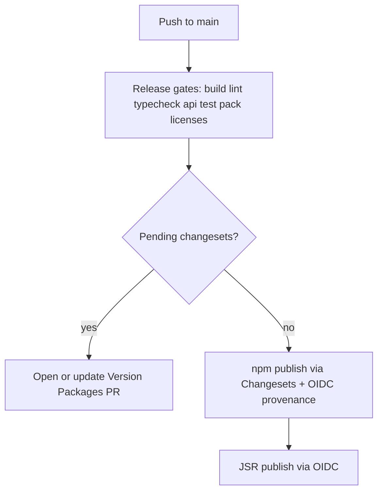

# Releasing

Publishing runs **only** from the upstream GitHub repository [`HariEshwar-J-A/node-jhora`](https://github.com/HariEshwar-J-A/node-jhora) on pushes to `main`. Forks and mirrors run CI but skip release jobs.

## Day-to-day: add a changeset

1. Make your code change on a feature branch.
2. Add a changeset describing user-visible impact:

    ```bash
    pnpm changeset
    ```

    Select the affected `@node-jhora/*` packages and choose semver bump levels. The changeset file lands in `.changeset/`.

3. Open a pull request. The `changeset-check` workflow (and label `no-changeset` when appropriate) gates missing changesets on user-facing package changes.

4. After merge to **upstream** `main`, the [Release](../../.github/workflows/release.yml) workflow runs.

## Release flow (upstream `main`)



1. **Release gates** (same workflow, before any publish): `pnpm build`, `lint`, `typecheck`, `api:check`, `test`, `check:pack`, `check:licenses`, `check:copyright`, `check:license-sync`, `check:jsr-versions`.
2. **Version Packages PR**: If `.changeset/*.md` files remain, [`changesets/action`](https://github.com/changesets/action) runs `pnpm changeset version`, commits bumped `package.json` / changelogs, and opens or updates a PR titled **Version Packages**.
3. **npm publish**: When `main` has **no** pending changesets (typically after merging **Version Packages**), the action runs `pnpm changeset publish` (which uploads via the **npm** CLI). npm **Trusted Publishing** (GitHub Actions OIDC) supplies credentials — no `NPM_TOKEN`. The release job installs **npm 11.5.1** globally because Node 22 runner images still bundle npm 10.x; trusted publishing requires npm CLI ≥ 11.5.1 ([npm trusted publishers](https://docs.npmjs.com/trusted-publishers/)). Provenance is requested with `NPM_CONFIG_PROVENANCE=true` ([generating provenance](https://docs.npmjs.com/generating-provenance-statements/)); GitHub’s GA post notes provenance is automatic for trusted publishing on public repos ([changelog](https://github.blog/changelog/2025-07-31-npm-trusted-publishing-with-oidc-is-generally-available/)). pnpm 12.12+ also documents OIDC for `pnpm publish` when the global npm CLI supports it ([pnpm 12.12.1 release notes](https://pnpm.io/blog/releases/12.12.1)).
4. **JSR publish**: When npm publish succeeds (`published == true`), a follow-up job runs `npx jsr publish` for each JSR package (OIDC, same repository guard).

Concurrency group `release-Release-<ref>` prevents overlapping releases.

### npm packages (14)

All non-private packages under `packages/`:

| Package                  |
| ------------------------ |
| `@node-jhora/analytics`  |
| `@node-jhora/api`        |
| `@node-jhora/atlas`      |
| `@node-jhora/core`       |
| `@node-jhora/engine`     |
| `@node-jhora/eop`        |
| `@node-jhora/ephe`       |
| `@node-jhora/ephe441`    |
| `@node-jhora/ephe-long`  |
| `@node-jhora/events`     |
| `@node-jhora/format`     |
| `@node-jhora/match`      |
| `@node-jhora/prediction` |
| `@node-jhora/reporting`  |

Private workspace packages (`@node-jhora/bench`, `@node-jhora/testkit`) and `@node-jhora/docs` are not published.

### JSR packages (10)

TypeScript libraries published to [JSR](https://jsr.io) as `@node-jhora/<name>`:

| JSR package              | Notes                                                                                                                                                                    |
| ------------------------ | ------------------------------------------------------------------------------------------------------------------------------------------------------------------------ |
| `@node-jhora/analytics`  |                                                                                                                                                                          |
| `@node-jhora/api`        |                                                                                                                                                                          |
| `@node-jhora/atlas`      | Gazetteer **data** is loaded from a directory at runtime; npm tarball may ship prebuilt shards. JSR ships source — point `loadGazetteerFromDirectory` at your data path. |
| `@node-jhora/core`       | Peer: `npm:@node-jhora/ephe` for the DE440s kernel. npm-only subpaths: `./node/register`, `./node/ephemeris` (Node filesystem loaders).                                  |
| `@node-jhora/engine`     |                                                                                                                                                                          |
| `@node-jhora/events`     |                                                                                                                                                                          |
| `@node-jhora/format`     |                                                                                                                                                                          |
| `@node-jhora/match`      |                                                                                                                                                                          |
| `@node-jhora/prediction` |                                                                                                                                                                          |
| `@node-jhora/reporting`  |                                                                                                                                                                          |

**npm only (not on JSR)**

| Package                 | Reason                                                                     |
| ----------------------- | -------------------------------------------------------------------------- |
| `@node-jhora/ephe`      | DE440s `.bsp` kernel (~31 MB unpacked) — exceeds practical JSR size limits |
| `@node-jhora/eop`       | Binary EOP kernel — npm distribution                                       |
| `@node-jhora/ephe441`   | DE441 chunk **build** tooling tied to large npm chunk packages             |
| `@node-jhora/ephe-long` | DE431 long-range chunk **build** tooling                                   |

Deno and Bun consumers should depend on ephemeris data via `npm:@node-jhora/ephe` (and `npm:@node-jhora/eop` when needed).

### Version sync

Each JSR package has `packages/<name>/jsr.json`. Its `version` must match `package.json`. After a changeset version bump:

```bash
pnpm jsr:sync-versions
pnpm check:jsr-versions   # also runs in test:tools / release gates
```

Local JSR validation:

```bash
pnpm build
pnpm jsr:dry-run
```

## One-time owner setup

### npm Trusted Publishing

For **each** npm package listed above (and any legacy scopes such as `node-jhora` if applicable):

1. Sign in at [npmjs.com](https://www.npmjs.com/).
2. Open the package → **Settings** → **Trusted Publishers**.
3. Add **GitHub Actions**:
    - **Owner**: `HariEshwar-J-A`
    - **Repository**: `node-jhora`
    - **Workflow filename**: `release.yml`
    - **Environment**: (leave empty unless you use one)

The [Release](../../.github/workflows/release.yml) workflow runs `npm install -g npm@11.5.1` before publish (Node 22 images bundle npm 10.x). Grant the workflow `id-token: write`, `contents: write`, and `pull-requests: write`. No long-lived npm token is stored in GitHub secrets.

### JSR

For each JSR package (`@node-jhora/analytics`, `@node-jhora/api`, `@node-jhora/atlas`, `@node-jhora/core`, `@node-jhora/engine`, `@node-jhora/events`, `@node-jhora/format`, `@node-jhora/match`, `@node-jhora/prediction`, `@node-jhora/reporting`):

1. Create the package under the `@node-jhora` scope on [jsr.io](https://jsr.io).
2. In package **Settings**, link the GitHub repository **`HariEshwar-J-A/node-jhora`** for OIDC publishing.
3. Confirm `jsr.json` in the repo matches the package name and that CI `check:jsr-versions` is green.

### Verify runtimes locally

```bash
pnpm install --frozen-lockfile
pnpm build
node tools/runtime-smoke-bun.mjs
deno run --allow-read tools/runtime-smoke-deno.ts
```

PRs run [runtime-smoke.yml](../../.github/workflows/runtime-smoke.yml) automatically.

## Commercial licensing contact

Root and package `LICENSE` files (section 4) list commercial licensing contact: [harieshwar.dev@gmail.com](mailto:harieshwar.dev@gmail.com) and [harieshwar.dev](https://harieshwar.dev). `tools/check-license-sync.mjs` keeps `packages/*/LICENSE` identical to the root file.
